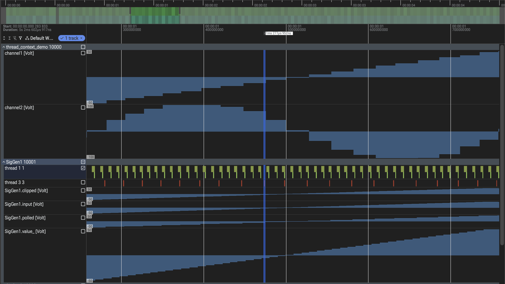

# thread_context_demo — context and spans for multiple instances

Experimental. Demonstrates how XCPlite can measure individual time series when the same code runs for several class instances
or in several threads, using a concept borrowed from OpenTelemetry (OTel): context, scope and span.

The API extensions are part of the XCPlite C++ API, in [inc/xcplib_context.hpp](../../inc/xcplib_context.hpp)
(included by `xcplib.hpp`). They need the option `OPTION_DAQ_CONTEXT_LIST`, which is enabled in the default and the shm
configuration, the configurations with on-target A2L generation.

---

## The problem

An XCP event is bound to a code location. The demo has two instances of a signal generator class, each
running its own thread. Instrumented in the obvious way, with one `DaqEventVar(siggen, A2L_MEAS(value_, ...))`
in the task function, both instances trigger the same event `siggen` and the tool receives one signal
`value_` with the values of both instances mixed.

The existing solution (see `cpp_demo`) needs the instrumented code to know its instance
and pass the name along: one dynamically created event per instance, and measurements registered with the instance name as
prefix. Shared helper functions, which do not know for which instance they are working, can not be
attributed at all.

## The concept

| Term | Meaning |
|---|---|
| `xcp::Context` | A named identity, "who is executing". One per class instance here (`SigGen1`, `SigGen2`). |
| `xcp::Scope` | Makes a context the current context of the calling thread and restores the previous one at the end of the block. The current context is in thread-local storage. |
| `DaqEventCtxVar` | Context-aware variant of `DaqEventVar`. Uses a separate event and separate measurements for each context, the event is named `<context>.<event>`. |
| `DaqSpan` | A named, timed section of code. Begin and end are recorded on the event `<context>.spans` of the current context. |

```cpp
xcp::Context context_;                                  // class member, constructed with the instance name
xcp::Scope scope(context_);                             // in the thread or method which works for this instance
DaqEventCtxVar(siggen, A2L_MEAS_PHYS(value_, ...));     // event SigGen1.siggen, measurement SigGen1.value_
{ DaqSpan(calc); ... }                                  // span "calc", ends at the end of the block
```

With a current context, the instrumented code needs no instance parameter. The shared function `Clip()`
in [src/sig_gen.cpp](src/sig_gen.cpp) is instrumented without knowing its instance and still delivers
`SigGen1.clipped` and `SigGen2.clipped`.

## What the demo measures

| Event | Measurements | Triggered by |
|---|---|---|
| `SigGen1.siggen`, `SigGen2.siggen` | `SigGen1.value_`, `SigGen2.value_` | the task thread of each instance |
| `SigGen1.clip`, `SigGen2.clip` | `SigGen1.input`, `SigGen1.clipped` (same for `SigGen2`) | the shared function `Clip()` |
| `SigGen1.poll`, `SigGen2.poll` | `SigGen1.polled`, `SigGen2.polled` | the main thread, method `Poll()` attaches the context of its instance |
| `SigGen1.spans`, `SigGen2.spans` | `.span`, `.level`, `.span_dt`, `.thread` | begin and end of each span in this context |
| `mainloop` | `channel1`, `channel2` | the main loop |

The span signals of one context show the sequence calc (level 1), clip (level 2), calc, none, with the
duration of the span that just ended in `span_dt`. Span names are displayed through the enum conversion
`conv.spans`, which the A2L generator creates from all span names registered when the A2L file is finalized.

The event names carry the context name, so the event list and the event groups of the tool show what an
event contains (`SigGen1.siggen` instead of a numbered event instance).

`.thread` is a small index of the thread which began or ended the span (`OPTION_DAQ_SPAN_THREAD`, enabled by default). The indices
are assigned in the order in which the threads begin their first span. In this demo each context is executed by two threads, its
task thread and the main thread which calls `Poll()`. The thread index tells their spans apart.

The spans of the demo contain sleeps of 1 ms (`clip`, `poll`) and 2 ms (`calc`) to simulate work, so that they are easy to see
in a trace viewer.

## Building and running

```bash
./build.sh examples
./build/thread_context_demo
```

Or with CMake directly:

```bash
cmake -B build -S . -DXCPLITE_BUILD_EXAMPLES=ON -DCMAKE_BUILD_TYPE=Debug
cmake --build build --target thread_context_demo
./build/thread_context_demo
```

Measure all signals with xcpclient for 5 seconds into a CSV file:

```bash
xcpclient --udp --mea '.*' --time 5 --csv mea.csv
```

## Viewing the spans in Perfetto

xcpclient can write the measurement as a trace file for [Perfetto](https://ui.perfetto.dev):

```bash
xcpclient --udp --mea '.*' --time 5 --perfetto trace.json
```

Open `trace.json` with "Open trace file" in the Perfetto UI. Each context is shown as a process: `SigGen1` and `SigGen2` have a track
for their task thread with the nested spans `calc` and `clip`, and a track for the main thread with the span `poll`. The signals of a
context (`SigGen1.value_`, `SigGen1.clipped`, ...) are counter tracks in the process of their context, `channel1` and `channel2` are in
the process `thread_context_demo`. Details are in the [xcpclient README](../../tools/xcpclient/README.md).

Overview of about 500 ms: the main loop signals `channel1` and `channel2`, below them the context `SigGen1` with the spans of its task
thread (`thread 1`), the spans of the main thread (`thread 3`) and its signals.



Zoomed in to 40 ms: `clip` is nested in `calc` in the task thread of each context. `poll` is executed by the main thread for both
contexts, one after the other, independent of the task threads, so it may overlap their spans.


## How it differs from OpenTelemetry

The thread-local current context, the rules for threads (capture in the parent, attach in the new thread,
detach at the end) and spans with nesting are taken over unchanged. Three things are different:

- **A context is named and long-lived.** In OTel a context is an anonymous trace id and span id, created
  per request, and every span is exported as a self-describing record. An XCP tool needs every signal
  declared in the A2L file with a name, an address and a fixed event. So there are a few named contexts,
  and each one gets its own events and measurements.
- **OTel separates instances with attributes, not with the context.** The idiomatic OTel solution is one
  signal name with an attribute such as `siggen.instance`, and the backend groups by it. A2L has no
  equivalent, so there is one signal per instance.
- **One guard instead of two.** OTel separates the lifetime of a span (`span->End()`) from being the
  current span of a thread (scope). `DaqSpan` combines both, which is enough for synchronous sections in
  one thread. A span which begins in one thread and ends in another can not be expressed.

## OpenTelemetry version for comparison

[otel/](otel/) contains the same demo instrumented with opentelemetry-cpp instead of XCP, as a reference
for reading. It is not built by the XCPlite build and has not been compiled. Build and run notes,
including a receiver for visualisation, are in the header of [otel/src/main.cpp](otel/src/main.cpp).

---

## Implementation notes

An event index > 0 always means a context. The library knows the context names, and an event which belongs to a context is named
`<context>.<event>` in the A2L event list, the event groups, `conv.events` and `GET_DAQ_EVENT_INFO` (`SigGen1.siggen`).

Library

- Options `OPTION_DAQ_CONTEXT_LIST`, `OPTION_DAQ_CONTEXT_COUNT` (8), `OPTION_DAQ_SPAN_COUNT` (32) and `OPTION_DAQ_SPAN_THREAD`,
  see [docs/xcplib_cfg.md](../../docs/xcplib_cfg.md). Enabled in the default and the shm configuration, undefined in ptp, raw,
  no_a2l and rtos.
- [src/ctx.c](../../src/ctx.c), `src/ctx.h`: context list and span name list next to the event list. `XcpCreateContext`,
  `XcpGetContextName`, `XcpGetContextCount`, `XcpCreateContextEvent`, `XcpRegisterSpanName`.
- [inc/xcplib_context.hpp](../../inc/xcplib_context.hpp), included by `xcplib.hpp`: `xcp::Context`, `xcp::Scope`, `xcp::Span`,
  `DaqSpan`, `DaqEventCtxVar`, `DaqEventCtxVar_`. There is no C instrumentation API for contexts.
- The span event of a context is `<context>.spans`. A sample is the state after a span begin or end: `span`, `level`, `span_dt`
  and, with `OPTION_DAQ_SPAN_THREAD`, `thread`. The record has 8 bytes with and without the option, `level` has 8 bit with the
  option and 16 bit without.
- The A2L writer creates `conv.spans` at finalize from the registered span names.
- `XcpFindEvent` and `XcpCreateEvent` consider events without context only, so an event `<name>` and `<context>.<name>` can
  coexist. `XcpGetEventContext` returns the context id of an event. The A2L short name of an event is its name without the context.
- Test: `test/context_test`, registered with CTest (unit).

Persistence

- The context name is stored with each event in the binary persistence file, the context list is rebuilt from the events on load.
- `tools/bintool` shows an event which belongs to a context as `<context>.<event>`, with the context name and id.
- The demo uses `A2L_MODE_WRITE_ONCE`: after a change which affects the A2L file without a new EPK, for example toggling
  `OPTION_DAQ_SPAN_THREAD`, delete the `.a2l` and `.bin` file in the working directory.

## Memory consumption

Memory is almost entirely fixed by three configuration options in `xcplib_cfg.h`. The number of
`DaqEventCtxVar` code locations matters mainly because each one needs event list entries.
The sizes are measured on a 64 bit build of the default configuration.

Fixed, allocated whether or not a context is used:

| Setting | Default | Per entry | Total |
|---|---|---|---|
| `OPTION_DAQ_EVENT_COUNT` | 16 | 28 bytes per event | 452 bytes |
| `OPTION_DAQ_CONTEXT_COUNT` | 8 | 16 bytes per context | 130 bytes |
| `OPTION_DAQ_SPAN_COUNT` | 32 | 32 bytes per span name | 1026 bytes |
| Event name buffer | | | 32 bytes |

The context feature itself adds about 1.2 KB with the defaults, most of it is the span name table.

Per use, in the application:

| Item | Size | Count |
|---|---|---|
| `DaqEventCtxVar` code location (event id cache) | 2 x (`OPTION_DAQ_CONTEXT_COUNT` + 1) = 18 bytes | per code location |
| Mutex for the first-time registration | 64 bytes on macOS, 40 bytes on Linux | per distinct combination of measurement types, not per code location |
| `xcp::Context` object | 24 bytes | per context |
| Current context and span | 16 bytes thread-local | per thread which uses a scope or a span |
| Thread index (`OPTION_DAQ_SPAN_THREAD`) | 1 byte thread-local | per thread which uses a span |
| `DaqSpan` code location | 2 bytes and a static initialization guard | per code location |

The number of events is what has to be planned. With C contexts and L `DaqEventCtxVar` code locations:

```
events = C (one spans event per context) + C x L + code locations also executed without a context + other events
```

Only combinations which are actually executed create an event. Worst case with the default of 8 contexts:

| Code locations L | Events needed | Event list | Fits the default of 16 events |
|---|---|---|---|
| 1 | 16 | 448 bytes | yes, with no other event |
| 2 | 24 | 672 bytes | no |
| 4 | 40 | 1.1 KB | no |
| 8 | 72 | 2.0 KB | no |
| 16 | 136 | 3.8 KB | no |

This demo has 2 contexts, 3 code locations and the event `mainloop`, which is 9 events. The limit is
1000 events (`OPTION_DAQ_EVENT_COUNT`). When the event list is full, `DaqEventCtxVar` measures nothing
for this context and code location, and tries to create the event again on every call.

Not affected by the number of contexts or code locations:

- `OPTION_DAQ_MEM_SIZE` (3072 bytes) is used with 6 bytes per signal which the tool selects for
  measurement, independent of how many signals are declared.
- The A2L generator writes to the file, it does not keep the declarations in memory.
- The binary persistence file grows by 256 bytes per event.

## Findings and limitations

- **Event budget.** One event per context, plus one per context and context-aware code location
  (9 events in this demo, `OPTION_DAQ_EVENT_COUNT` is 16 by default). The number of contexts is limited
  by `OPTION_DAQ_CONTEXT_COUNT` (8), the number of span names by `OPTION_DAQ_SPAN_COUNT` (32).
- **Monotonic timestamps.** The timestamps of an XCP event must be monotonic. A context can be attached
  to several threads at the same time (task thread and `Poll()` from the main thread), so the span events
  of a context are serialized with a spin lock. A context-aware event must not be triggered concurrently
  by several threads in the same context at the same code location.
- **A2L timing.** Contexts, context-aware events and spans must have been executed once before the A2L
  file is finalized.
- **Span duration.** `span_dt` belongs to the span that just ended, the end sample does not name it.
- **Thread index.** `.thread` is an index local to the process, not the thread id of the operating system, and limited to 255 threads.
  Without `OPTION_DAQ_SPAN_THREAD`, the spans of several threads in one context can not be told apart.
- **Attach starts without a span.** The current span of the capturing thread is not carried over.
- **Default and shm configuration only.** Needs runtime event creation and on-target A2L generation.
  In SHM mode, each application has its own namespace for context names, see [docs/SHM.md](../../docs/SHM.md).
- **Library implementation.** The context names are kept in a context list in the C core
  ([src/ctx.c](../../src/ctx.c)), an event stores the id of its context. The binary persistence file
  stores the context name with each event, so event ids are stable across restarts. There is no C
  instrumentation API for contexts.
- **Names.** Context and event names are limited to 15 characters each.

## Open questions

- Should a context capture the current context when the instance does not know its own name?
- How far should the naming follow OTel? An OTel tracer has a name but no id, it is only a factory for
  spans. The trace id belongs to the trace, which is the set of all spans sharing that id.
- SHM configuration: how to make context and event creation process safe? Two applications must not create contexts or events at
  the same time. Not tested with xcpdaemon yet.

## Remaining todos

- `.bin`/`.hex` matching in `test/test_examples.sh` does not cover fixed-version file names, so `cpp_demo.hex` is not compared.
- `span_dt` is not attributed to a span name, the end sample only carries the duration.
- Two `xcp::Context` objects with the same name share the context but not the spin lock, so their span events are not serialized.
  Currently only documented as "create one object per name".
- `DaqSpan` executed before `XcpInit` keeps span id 0 permanently, because the id is a function-local static.
- A context-aware event triggered concurrently by several threads in the same context at the same code location can produce
  non-monotonic timestamps. Only the span event is serialized.
- Update the CANape project for thread_context_demo.
- The OTel version in [otel/](otel/) has never been compiled.

## Possible follow-ups

- Perfetto native protobuf format, if the JSON files get too large (about 90 bytes per span or signal sample).
- A `--raw` switch in xcpclient for unconverted values in console and CSV.
- Contexts and spans for no_a2l/rtos targets (needs link-time registration).
- A group per context in the A2L file, containing the event groups of the context.
- Optional connection to a real OTel backend, on target through opentelemetry-cpp or off target by
  exporting span records from xcpclient.

## Things to know about xcpclient

- **Span signals must be measured.** `--perfetto` finds a context by its signals `<context>.span`, `.level` and `.span_dt`. Other
  signals are assigned to a context only by the name prefix `<context>.`.
- **Trace timestamps** are relative to the measurement start. The file is not sorted by time, Perfetto sorts on import.
- **Timestamp extension.** At least one sample of any event is needed every 2.147 s (with 1 ns ticks), otherwise the 64 bit
  timestamp is ambiguous.
- **Bool signals are enums.** `conv.bool` is read as `0 "false" 1 "true"`, so bools are printed as labels and are state tracks
  in Perfetto.
- **CSV format.** The CSV file has the columns `time_ns,daq,name,value,unit`, the values are physical values or enum labels.

