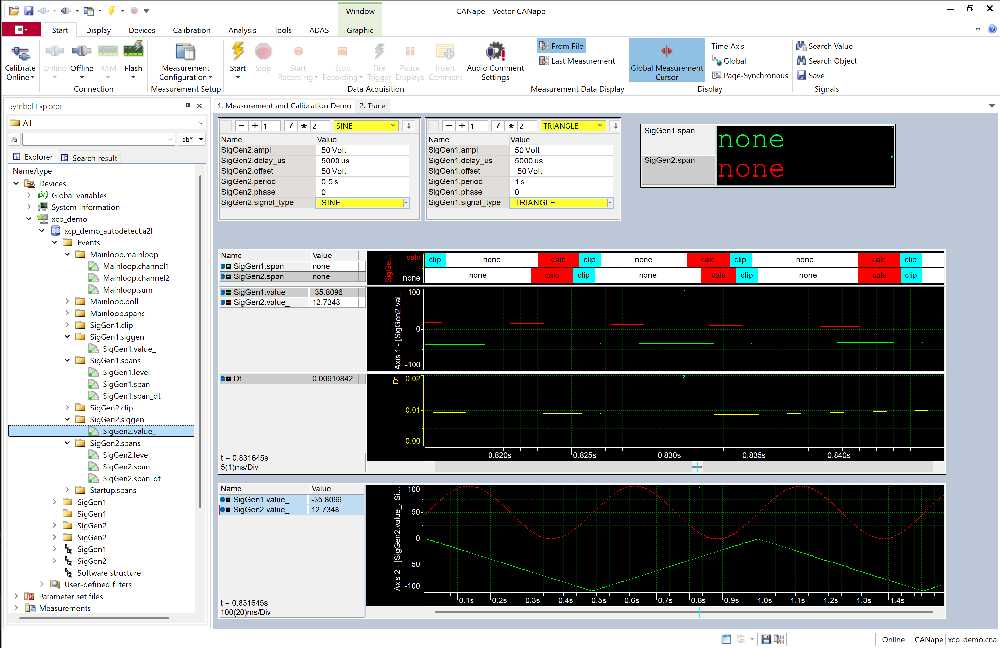
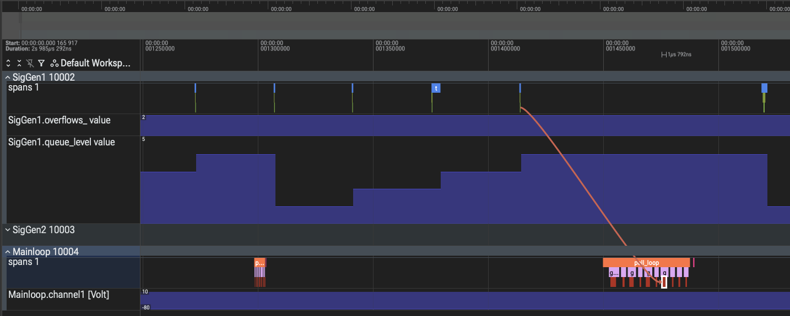
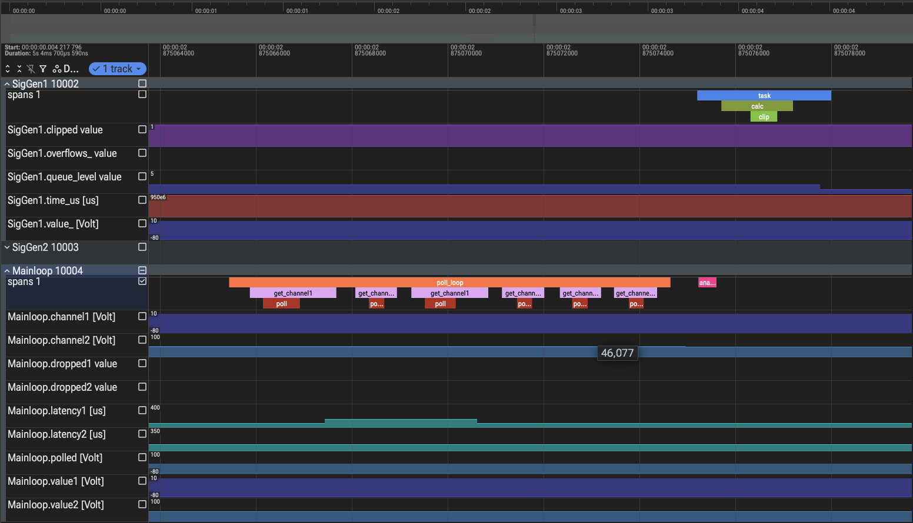

# thread_context_demo — context, spans and links for multiple threads and instances

Demonstrates how XCPlite can measure individual time series when the same code runs as several class instances or in several threads, using concepts borrowed from OpenTelemetry (OTel): context, scope and span.


## Demo application

The demo has a class called `SignalGenerator`. Each instance of a signal generator creates a cyclic task (thread) which calculates a configurable waveform in real time. Each instance has its own calibration parameters like `sample_time_us`, `signal_type`, `period`, `ampl`, the output limits `clip_min` and `clip_max`, ... The output samples can be read by other threads. The poll function returns one sample (value, time), or nothing when there is no new sample. It may be called from any thread by using a lock-free single producer single consumer (SPSC) queue owned by the signal generator. 

The demo main loop polls 2 instances of `SignalGenerator` until both queues (16 and 1 entries) are empty and then sleeps for some time. The queue size is a parameter of the signal generator instance. If the queue size is 1, the queue always holds the latest sample, a new sample overwrites an unread one.
 


## What can be measured and observed

The demo shows how to observe the signal generation, the execution of the poll function, the queue level and the overflow count inside the `SignalGenerator` implementation, without the code knowing which instance it is and who calls the poll function. The instrumentation creates a consistent time series for each instance, so a standard XCP client tool or logger does not need to know how to interpret and demultiplex the data produced by the capture points in the code. The tool selects at runtime which instance or caller it observed, no data is transferred and collected for instances which are not selected. The caller instrumentation provides metrics such as the latency of a sample, and a span link from the consumer span to the producer span of each sample, which Perfetto shows as an arrow.

The xcpclient tool has an option to convert the XCP measurement data to the Chrome JSON trace format, which can be loaded in Perfetto and many other tools.

---

## Building and running

```bash
./build.sh examples
./build/thread_context_demo
```

Or with CMake directly:

```bash
cmake -B build -S . -DXCPLITE_BUILD_EXAMPLES=ON -DCMAKE_BUILD_TYPE=Debug
cmake --build build --target thread_context_demo
./build/thread_context_demo
```

Measure all signals with xcpclient for 5 seconds into a CSV file:

```bash
xcpclient --udp --mea '.*' --time 5 --csv mea.csv
```

---

## Using CANape

The CANape project included, can measure the span event signal, but can not provide a Gantt-Chart with nested spans in a context. It is perfectly suited to visualize the individual signal time series. The screenshot was taken at a 100Hz sampling rate.




---

## Using Perfetto

xcpclient can write the measurement as a trace file (Chrome JSON trace format) for [Perfetto](https://ui.perfetto.dev):

```bash
xcpclient --udp --mea '.*' --time 5 --perfetto trace.json
```
or remote

```bash
xcpclient --udp --dest-addr 192.168.0.206 --upload-a2l --mea '.*' --time 5 --perfetto trace.json
```

It is enough to measure the signals of interest, xcpclient adds the span and link signals of the contexts automatically (`--trace-auto` is default):

```bash
xcpclient --udp --mea 'Mainloop.channel1' --time 5 --perfetto trace.json
```

Open `trace.json` with "Open trace file" in the Perfetto UI. Each context is shown as a process with one track `spans` and a counter
track for each of its signals:

- `Mainloop`: `poll_loop` with the nested spans `get_channel1` and `get_channel2`, a `poll` nested in each of them, followed by
  `analyze`. The signals are `Mainloop.channel1`, `Mainloop.channel2`, `Mainloop.polled` and the sample signals `.value1`, `.latency1`, `.dropped1`, `.value2`, `.latency2`, `.dropped2`.
- `SigGen1`, `SigGen2`: `task` with the nested span `calc`, which has the nested span `clip`, and the signals `.value_`, `.time_us`, `.queue_level`, `.overflows_` and `.clipped`.

The main loop and the two task threads run independently, so the spans of different contexts overlap in time.
Each `poll` of `Mainloop` which returned a sample has an arrow from the `task` span of the signal generator which calculated it, see "Span links and Perfetto arrows". Details are in the [xcpclient README](../../tools/xcpclient/README.md).

### Screenshots

#### Signals

This screenshot below shows the generated sine (SigGen2) and clipped triangle (SigGen1) signals from producer context (SigGen1,SigGen2) and consumer context (Mainloop) perspective:


#### Queue level

The next zoomed in screenshot below shows the queue level of signal generator 1 (queue size = 16).  
The main loop always empties both queues in span 'poll_loop', before it goes to sleep for 100us (10kHz).  
The sample rate of SigGen1 is 25us (40kHz).   



Created with:
```bash
xcpclient --udp --mea 'Mainloop.channel1' 'SigGen1.queue_level' 'SigGen1.overflows_' --perfetto trace.json  --trace-auto all
```


#### Producer consumer links

The screenshot below zoomed into a 5us time range, shows a span link in more detail.   
The arrow connects the producer span calc in the thread of signal generator instance 1, to the consumer span 'poll' in the mainloop thread, when it got a new value. 
It was created with:

```bash
xcpclient --udp --mea 'Mainloop.channel1' --perfetto trace.json --trace all
```

It measures only 'Mainloop.channel1' and with '--trace all' xcpclient added all required context, span and link information, which leads to about 0.5 million events per second.    




---

## How it differs from OpenTelemetry

The thread-local current context, the rules for threads (capture in the parent, attach in the new thread, detach at the end) and spans with nesting are taken over unchanged. Three things are different:

- **A context is named and long-lived.** In OTel a context is an anonymous trace id and span id, created per request, and every span is exported as a self-describing record. An XCP tool needs every signal declared in the A2L file with a name, an address and a fixed event. So there are a few named contexts, and each one gets its own events and measurements.
- **OTel separates instances with attributes, not with the context.** The idiomatic OTel solution is one signal name with an attribute such as `siggen.instance`, and the backend groups by it. A2L has no equivalent, so there is one signal per instance.
- **One guard instead of two.** OTel separates the lifetime of a span (`span->End()`) from being the current span of a thread (scope). `DaqSpan` combines both, which is enough for synchronous sections in one thread. A span which begins in one thread and ends in another can not be expressed.

The differences in the data model and in the treatment of time, order and causality are described in
[docs/TIME_AND_CAUSALITY.md](../../docs/TIME_AND_CAUSALITY.md).


---

## XCPlite API extensions

The XCPlite API extensions needed are part of the XCPlite C++ API, in [inc/xcplib_context.hpp](../../inc/xcplib_context.hpp) (included by `xcplib.hpp`). They need the option `OPTION_DAQ_CONTEXT_LIST`, which is enabled in the default and the shm configuration, the configurations with on-target A2L generation. They cost nothing when not used.

The API extensions follow the XCPlite principles in on-target A2L generation mode: lazy registration, lock-free and no heap allocations. Span names may be registered at link time (`OPTION_DAQ_SPAN_SECTION_REGISTRATION`), contexts and their events at runtime. Contexts for no_a2l and rtos targets would need link-time registration of contexts and events as well (see "Possible follow-ups").

| Term | Meaning |
|---|---|
| `xcp::Context` | A named identity, "who is executing". One per class instance here (`SigGen1`, `SigGen2`), and one for each phase of the main thread (`Main`, `Mainloop`). |
| `xcp::Scope` | Makes a context the current context of the calling thread and restores the previous one at the end of the block (for context propagation). The current context is ambient in thread-local storage. |
| `DaqContext` | Creates a context with a literal name once per code location and enters it with a scope until the end of the block. Used here for `Main` and `Mainloop`. |
| `DaqEventCtxVar` | Context-aware variant of the XCP event trigger function `DaqEventVar`. Uses a separate event and separate measurements for each context, the event is named `<context>.<event>`. |
| `DaqSpan` | A named, timed section of code. Begin and end are recorded on the same event `<context>.spans` of the current context. |
| `xcp::SpanLink` | The span context of a producer span (context, span, thread, timestamp), captured with `xcp::CaptureSpanLink()` and carried to a consumer, for example in a queue item. The consumer records it with `xcp::LinkSpan(link)` inside its own span, on the event `<context>.links` of its current context. An OTel span link. |

```cpp
xcp::Context context_;                                  // class member, constructed with the instance name
xcp::Scope scope(context_);                             // in the thread or method which works for this instance
DaqEventCtxVar(siggen, A2L_MEAS_PHYS(value_, ...));     // event SigGen1.siggen, measurement SigGen1.value_
{ DaqSpan(calc); ... }                                  // span "calc", ends at the end of the block
DaqContext(Mainloop);                                   // context with a literal name, entered until the end of the block
queue_.Push(SampleT{value_, ..., xcp::CaptureSpanLink()}); // producer, inside span "task": capture the span context
xcp::LinkSpan(sample->link);                            // consumer, inside span "poll": link it to the producer span
```

---

## What the demo measures

An XCP event is bound to a code location. The demo has two instances of a signal generator class, each running its own thread, and a poll function which other threads call to read the values. Instrumented in the obvious way, with one `DaqEventVar(event_name, A2L_MEAS(variable_name, ...))` in the code, both instances and all callers trigger the same event, and the tool receives one signal with the values of all instances or callers mixed.

The existing solution (see `cpp_demo`) needs the instrumented code to know its instance and pass the name along: one dynamically created event per instance, and measurements explicitly registered with the instance name as prefix. Shared helper functions for the signal generator, which do not know for which instance they are working, can not be instrumented at all.

The demo has four contexts. `SigGen1` and `SigGen2` are the two signal generator instances, each attached to its own task thread.
`Main` and `Mainloop` are attached to the main thread, `Main` for the whole run and `Mainloop` for each cycle of the main loop.

| Event | Measurements | Triggered by |
|---|---|---|
| `SigGen1.siggen`, `SigGen2.siggen` | `.value_`, `.time_us` (time stamp of the sample), `.queue_level` (unread samples after the push), `.overflows_` (dropped samples) of `SigGen1` and `SigGen2` | the task thread of each instance |
| `SigGen1.clip`, `SigGen2.clip` | `SigGen1.clipped`, `SigGen2.clipped` | the member function `Clip()`, which limits the output to the calibration parameters `clip_min` and `clip_max` |
| `Mainloop.poll` | `Mainloop.polled` | the method `Poll()` of both instances, called by the main loop |
| `Mainloop.links` | `Mainloop.link_context`, `.link_span`, `.link_time` (the producer span of the sample) | `xcp::LinkSpan()` in `Poll()`, for each sample |
| `Mainloop.sample1`, `Mainloop.sample2` | `Mainloop.value1`, `.latency1`, `.dropped1` and `Mainloop.value2`, `.latency2`, `.dropped2` | the main loop, for each sample polled from instance 1 or 2 |
| `Mainloop.mainloop` | `Mainloop.channel1`, `Mainloop.channel2` (latest values) | the main loop, once per cycle |
| `Main.spans`, `Mainloop.spans`, `SigGen1.spans`, `SigGen2.spans` | `.span`, `.level`, `.span_dt` | begin and end of each span in this context |

That is 13 events: 4 spans events, 2 for `clip` and 2 for `siggen` (one per instance), 4 for the code locations of the main loop and
`Poll()`, and the links event of `Mainloop`.

Spans:

| Context | Spans | Executed by |
|---|---|---|
| `Main` | `initialize`: creates the two signal generator instances | main thread, once |
| `Mainloop` | `poll_loop` with the nested spans `get_channel1` and `get_channel2` in turns until both queues are empty, each with a nested `poll`, then `analyze` | main thread, after an idle sleep of `Mainloop.idle_sleep_us` |
| `SigGen1`, `SigGen2` | `task` with the nested span `calc`, which has the nested span `clip` | task thread of the instance, with a sleep of `sample_time_us` after each cycle (25 us for `SigGen1`, 1 ms for `SigGen2`) |

Span names are displayed through the enum conversion `conv.spans`, which the A2L generator creates from all span names registered when the A2L file is finalized.

The event names carry the context name, so the event list and the event groups of the tool show what an event contains (`SigGen1.siggen` instead of a numbered event instance).

`Poll()` does not attach the context of its instance, it runs in the context of its caller. Its span `poll` is therefore nested in `get_channel1` or `get_channel2` in the context `Mainloop`, and this tells which instance was polled. The event `Mainloop.poll` is triggered for both instances, so `Mainloop.polled` contains the mixed values of both (just for demonstration). The alternative is in the code as a comment: with `xcp::Scope scope(context_)` in `Poll()`, the span and the event belong to the context of the instance (`SigGen1.poll`, `SigGen1.polled`). The span is then not nested in the span of the caller, because attaching a context starts without a current span, and the context is executed by two threads, see "Same context in multiple threads".

By default the spans show the real execution times: Perfetto displays them with ns resolution, the data rate goes up to about 10 MByte/s and xcpclient keeps up with it. For a view which is easier to follow, with a much lower data rate, enable `OPTION_SIMULATE_WORK` in [src/sig_gen.hpp](src/sig_gen.hpp): the spans then contain sleeps which simulate work.


## OpenTelemetry version for comparison

[otel/](otel/) contains the same demo (older version, not updated yet, no span links) instrumented with opentelemetry-cpp instead of XCP, as a reference for reading. It is not built by the XCPlite build and has not been compiled. Build and run notes, including a receiver for visualisation, are in the header of [otel/src/main.cpp](otel/src/main.cpp).


## Same context in multiple threads

In this demo the spans and context-aware events of each context are triggered by one thread only:

| Context | Thread | Spans |
|---|---|---|
| `Main` | main thread | `initialize` |
| `Mainloop` | main thread | `poll_loop`, `get_channel1`, `get_channel2`, `poll`, `analyze` |
| `SigGen1`, `SigGen2` | task thread of the instance | `task`, `calc`, `clip` |

So the demo does not need `OPTION_DAQ_SPAN_THREAD` in `xcplib_cfg.h`, which is not defined by default. With the option, the spans event of a context has the additional measurement `.thread`, a small index of the thread which began or ended the span, and xcpclient writes one track per thread. The indices are assigned in the order in which the threads begin their first span.

Places which look as if they break the rule, but do not:

- `Poll()` runs in the main thread. It does not attach the context of its instance (`xcp::Scope scope(context_)` is commented out), so its span `poll` belongs to the context of the caller, `Mainloop`, not to `SigGen1` or `SigGen2`.
- `Clip()` is called from `Task()` only, so it always runs in the task thread of its instance.
- The constructor, `Start()` and `Stop()` run in the main thread. The constructor creates the context, but none of them begins a span or triggers an event in it.
- `Main` and `Mainloop` are both executed by the main thread. One thread working in several contexts is fine, the option is about the other direction: several threads in one context.

To keep in mind:

- This is a convention, nothing enforces it. With `xcp::Scope scope(context_)` enabled in `Poll()`, `SigGen1` gets spans from two threads, the task thread and the main thread. Without the option, xcpclient puts the begin and end samples of both threads on one level stack, and they corrupt the nesting of each other.
- The library needs one thread at a time per context, not exactly one. Handing a context from one thread to another without the option is fine, as long as the first thread has ended its spans before the next one begins. See also "Findings and limitations".


## Span links and Perfetto arrows

A sample is calculated in the span `task` of a signal generator thread and polled later, in the span `poll` of the main loop, in another thread and another context. The two spans have no parent and child relation and are not nested, their relation is a span
link, as in OpenTelemetry:

- The producer captures the span context of its current span with `xcp::CaptureSpanLink()` and puts it into the sample (`SampleT::link`, a trivially copyable `xcp::SpanLink` of 16 bytes). The link carries the producer context id, the current span id, the thread index (`OPTION_DAQ_SPAN_THREAD`) and the clock at the capture. Nothing is measured on the producer side.
- The consumer records the link with `xcp::LinkSpan(sample->link)` inside its span `poll`. This triggers the event `<context>.links` of
  its current context (`Mainloop.links`) with the measurements `.link_context` (enum `conv.contexts`), `.link_span` (enum `conv.spans`)
  and `.link_time`, plus `.link_thread` and `.link_consumer_thread` with `OPTION_DAQ_SPAN_THREAD`. The event is created on the first
  link in a context, a context without links costs nothing.

The link identifies the producer span by its track (context and thread) and a timestamp, not by a span instance id. `xcpclient --perfetto` writes each link sample as a flow: the start on the producer track at the capture time, the end on the consumer track at the time of the `LinkSpan` sample. Perfetto binds each end to the innermost slice which encloses its timestamp, so the arrow goes from the span in which the link was captured (`task`, the push happens after `calc` has ended) to the span in which it was recorded (`poll`). Nothing is kept per span, in the target or in xcpclient. A link whose producer context is not measured, or which was captured before the measurement start, is counted and dropped. A link captured in a span which began before the measurement start has no producer slice, Perfetto does not draw it.

To see the arrows, expand the tracks and click a `poll` slice: the arrow from its `task` is drawn, the details panel lists it under "Preceding flows" with the delay. Clicking a `task` slice shows its outgoing arrow. With `SigGen1` at 25 us there are many links, zoom in to a few cycles of the main loop.

The analysis behind this (Perfetto flow formats, OTel links, alternatives) and two example traces are in [perfetto_flow/README.md](perfetto_flow/README.md).

---

## Implementation notes

An event stores the id of its context and its XCP event, a context id > 0 means that the event belongs to a context (0 = no context). The library knows the context names, and an event which belongs to a context is named `<context>.<event>` in the A2L IF_DATA event list.

### Library

- Options `OPTION_DAQ_CONTEXT_LIST`, `OPTION_DAQ_CONTEXT_COUNT` (8), `OPTION_DAQ_SPAN_SECTION_REGISTRATION`, `OPTION_DAQ_SPAN_COUNT` (32) and `OPTION_DAQ_SPAN_THREAD`, see [docs/xcplib_cfg.md](../../docs/xcplib_cfg.md). Enabled in the default and the shm configuration, undefined in ptp, raw, no_a2l and rtos. `OPTION_DAQ_SPAN_THREAD` is not defined by default.
- [src/ctx.c](../../src/ctx.c), `src/ctx.h`: context list next to the event list, a lock-free name list ([docs/NAMELIST.md](../../docs/NAMELIST.md)). `XcpCreateContext`, `XcpGetContextName`, `XcpGetContextCount`, `XcpCreateContextEvent`.
- Span names: with `OPTION_DAQ_SPAN_SECTION_REGISTRATION` (default, not on Windows and not in SHM mode) `DaqSpan` emits a constant descriptor into the linker section `xcp_spans`, the span id is the position in the section. Otherwise `XcpRegisterSpanName` registers the name at runtime in a span name list, and `DaqSpan` caches the span id at the code location.
- [inc/xcplib_context.hpp](../../inc/xcplib_context.hpp), included by `xcplib.hpp`: `xcp::Context`, `xcp::Scope`, `xcp::Span`, `DaqContext`, `DaqSpan`, `DaqEventCtxVar`, `DaqEventCtxVar_`. There is no C instrumentation API for contexts.
- `DaqContext(name)` enters a context with a literal name for the enclosing block. The context object is a static at the code location and is created when the code location is executed for the first time, so code which is executed repeatedly does not search the context list each time. The demo enters its contexts with a literal name with `DaqContext`: `Main` once at the begin of `main()`, `Mainloop` in each cycle of the main loop. The signal generator instances use an `xcp::Context` member, because their name is only known at runtime and each instance needs its own context, a static at one code location would be shared.
- The span event of a context is `<context>.spans`. A sample is the state after a span begin or end: `span`, `level`, `span_dt` and, with `OPTION_DAQ_SPAN_THREAD`, `thread`. The record has 8 bytes with and without the option, `level` has 8 bit with the option and 16 bit without.
- The A2L writer creates `conv.spans` at finalize from the registered span names, and `conv.contexts` (id 0 `none`, 1.. the context names) for the producer context of span links.
- Span links: `xcp::SpanLink`, `xcp::CaptureSpanLink()`, `xcp::LinkSpan()`. The event `<context>.links` is created with the same claim scheme as `DaqEventCtxVar`, one state per context id for the program, on the first link in the context.
- `XcpFindEvent` and `XcpCreateEvent` consider events without context only, so an event `<name>` and `<context>.<name>` can coexist. `XcpGetEventContext` returns the context id of an event. The A2L short name of an event is its name without the context.
- Test: `test/context_test`, registered with CTest (unit).

### Persistence

- The context name is stored with each event in the binary persistence file, the context list is rebuilt from the events on load.
- `tools/bintool` shows an event which belongs to a context as `<context>.<event>`, with the context name and id.
- The demo uses `A2L_MODE_WRITE_ONCE`: after a change which affects the A2L file without a new EPK, for example toggling
  `OPTION_DAQ_SPAN_THREAD` or adding, renaming or reordering spans, delete the `.a2l` and `.bin` file in the working directory.
  The span ids are fixed for a binary, not for an EPK: a new build may have different span ids.
- Span names and span ids are not stored in the binary persistence file.


## Findings and limitations

- **Event budget.** One event per context, plus one per context and context-aware code location, plus one per context which records span links. The number of events is limited to `OPTION_DAQ_EVENT_COUNT`. The number of contexts by `OPTION_DAQ_CONTEXT_COUNT`, the number of span names by `OPTION_DAQ_SPAN_COUNT` (unlimited with link-time registration).
- **One thread at a time.** A context should be executed by one thread at a time. Several threads may work in it one after the other, the hand-over between them (a queue, a mutex, a join) keeps the timestamps of its events in order. A context and its spans describe one track of activity. For a worker pool, use one context per worker. See "Same context in multiple threads".
- **Declining timestamps.** The timestamps of an XCP event should not decline. If a context is attached to several threads at the same time (for example a task thread and a method called from another thread), this is not guaranteed. The order of the samples is decided when the event is queued, after the timestamp was taken, so a thread which is overtaken in between produces a sample with a declining timestamp. This applies to the span events of a context in which several threads work at the same time, and to a context-aware event triggered by several threads in the same context at the same code location. Nothing is serialized, a thread never waits for another one. With the thread index (`OPTION_DAQ_SPAN_THREAD`) the samples of each thread are still in order among themselves. `xcpclient` accepts a declining timestamp, other tools may not. Background, what was tried and why there is no lock: [docs/TIME_AND_CAUSALITY.md](../../docs/TIME_AND_CAUSALITY.md).
- **First execution.** The first execution of a `DaqEventCtxVar` code location in a context creates the event and registers the measurements. One thread does this (event list mutex, A2L lock). Other threads which execute the code location in the same context at this moment do not wait, they skip this one trigger. There is no mutex and no compiler generated once guard at the code locations of `DaqSpan`, `DaqContext` and `DaqEventCtxVar`.
- **A2L lazy generation.** Contexts and context-aware events must have been executed once before the A2L file is finalized (spans as well without `OPTION_DAQ_SPAN_SECTION_REGISTRATION`). Code which runs only once at startup can be measured from the second run on, see "Measuring the startup".
- **Span ids.** With `OPTION_DAQ_SPAN_SECTION_REGISTRATION` (default), span ids depend on the link order only: they are the same in every run of a binary, which is what `A2L_MODE_WRITE_ONCE` needs. A span name used at several code locations gets several span ids with the same name. With GCC, `DaqSpan` can not be used in inline functions, templates and member functions defined in the class body. Without the option, span ids depend on the order in which the spans are executed for the first time, this order must then not change between runs, otherwise `conv.spans` of the existing A2L file shows wrong span names.
- **Thread index.** `.thread` is an index local to the process, not the thread id of the operating system, and limited to 255 threads. Without `OPTION_DAQ_SPAN_THREAD`, the spans of several threads in one context can not be told apart.
- **Attach starts without a span.** The current span of the capturing thread is not carried over.
- **Default and shm configuration only.** Needs runtime event creation and on-target A2L generation. In SHM mode, each application has its own namespace for context names, see [docs/SHM.md](../../docs/SHM.md).
- **Library implementation.** The context names are kept in a context list in the C core
  ([src/ctx.c](../../src/ctx.c)), an event stores the id of its context. The binary  persistence file stores the context name with each event, so event ids are stable across restarts.
- **C++ only.** There is no C instrumentation API for contexts.


## Possible follow-ups

- Perfetto native protobuf format, if the JSON files get too large (about 90 bytes per span or signal sample).
- Contexts and spans for no_a2l/rtos targets (needs link-time registration).
- A group per context in the A2L file, containing the event groups of the context.
- Optional connection to a real OTel backend, on target through opentelemetry-cpp or off target by exporting span records from xcpclient.


## Historical: the first implementation in multi_thread_demo

The first experimental implementation of thread contexts, formerly in `multi_thread_demo` (`EXPERIMENTAL_THREAD_CONTEXT`), no longer in the code. Kept for reference.

```c

//-----------------------------------------------------------------------------------------------------
// Thread context
// Experimental

#ifdef EXPERIMENTAL_THREAD_CONTEXT

// Thread context structure
typedef struct {
    char name[MAX_THREAD_NAME_LENGTH + 1]; // Human-readable thread name
    tXcpEventId id;                        // XCP event ID for this thread
    tXcpEventId span_id;                   // XCP event ID for the current span
    uint32_t level;                        // Current span level
} tXcpContext;

// Global thread-local context
THREAD_LOCAL tXcpContext gXcpContext = {0};

// Inline accessors for maximum performance
static inline tXcpContext *XcpGetContext(void) { return &gXcpContext; }
static inline const char *XcpGetContextName(void) { return gXcpContext.name; }

// Begin a span, create a span event once
// Trigger the context event on entry
#define BeginSpan(name)                                                                                                                                                            \
    uint64_t span_t1 = ApplXcpGetClock64();                                                                                                                                        \
    uint64_t span_dt;                                                                                                                                                              \
    static _Atomic tXcpEventId span_id = XCP_UNDEFINED_EVENT_ID;                                                                                                                   \
    tXcpEventId old_span_id = XCP_UNDEFINED_EVENT_ID;                                                                                                                              \
    if (atomic_compare_exchange_strong_explicit(&span_id, &old_span_id, 1, memory_order_relaxed, memory_order_relaxed)) {                                                          \
        A2lLock();                                                                                                                                                                 \
        span_id = XcpCreateEvent(name, 0, 0);                                                                                                                                      \
        A2lSetStackAddrMode_i(span_id);                                                                                                                                            \
        A2lCreatePhysMeasurementInstance(name, span_dt, "Span runtime", "ns", 0.0, 0.1000000);                                                                                     \
        A2lUnlock();                                                                                                                                                               \
    }                                                                                                                                                                              \
    tXcpContext *ctx = XcpGetContext();                                                                                                                                            \
    tXcpEventId previous_span_id = ctx->span_id;                                                                                                                                   \
    ctx->span_id = span_id;                                                                                                                                                        \
    ctx->level++;                                                                                                                                                                  \
    XcpEventExtAt_Var(ctx->id, span_t1, 2, xcp_get_frame_addr(), (const uint8_t *)ctx);

// End span
// Trigger the span event and the context event on exit
// Measure execution time of the span
#define EndSpan()                                                                                                                                                                  \
    uint64_t span_t2 = ApplXcpGetClock64();                                                                                                                                        \
    span_dt = span_t2 - span_t1;                                                                                                                                                   \
    XcpEventExtAt_Var(ctx->span_id, span_t2, 2, xcp_get_frame_addr(), (const uint8_t *)ctx);                                                                                       \
    ctx->span_id = previous_span_id;                                                                                                                                               \
    ctx->level--;                                                                                                                                                                  \
    XcpEventExtAt_Var(ctx->id, span_t2, 2, xcp_get_frame_addr(), (const uint8_t *)ctx);

// Create a named context
// Create the context event (name is 'context_name'_'context_index')
// Register the context struct  as A2L typedef instance tied to the context event
static uint16_t XcpCreateContext(const char *context_name, uint16_t context_index) {

    if (!XcpIsActivated()) {
        return XCP_UNDEFINED_EVENT_ID; // Return undefined event ID if XCP is not activated
    }

    // Once:
    // Create a typedef for the thread context
    // Uses the predefined enum conversion rule for the event names
    A2lOnce() {
        A2lLock();
        A2lTypedefBegin(tXcpContext, &gXcpContext, "A2L typedef for tXcpContext");
        A2lTypedefPhysMeasurementComponent(span_id, "function span id", "conv.events", 0, 32);
        A2lTypedefMeasurementComponent(level, "function span nesting level");
        A2lTypedefEnd();
        A2lUnlock();
    }

    // Init thread local context
    // Create a unique name from index
    // Create an XCP event for this context
    snprintf(gXcpContext.name, sizeof(gXcpContext.name), "%s_%u", context_name, context_index);
    gXcpContext.id = XcpCreateEvent(gXcpContext.name, 0, 0);
    gXcpContext.span_id = gXcpContext.id;
    gXcpContext.level = 0;

    // Create a measurement typedef instance with the context name
    A2lLock();
    A2lSetRelativeAddrMode_i(gXcpContext.id, &gXcpContext); // Set relative addressing mode for the thread context
    A2lCreateTypedefNamedInstance(gXcpContext.name, gXcpContext, tXcpContext, "Thread local context");
    A2lUnlock();

    printf("Thread context created: name = %s, id = %u\n", gXcpContext.name, gXcpContext.id);
    return gXcpContext.id;
}

#else
#define BeginSpan(name)
#define EndSpan()
#endif

```
